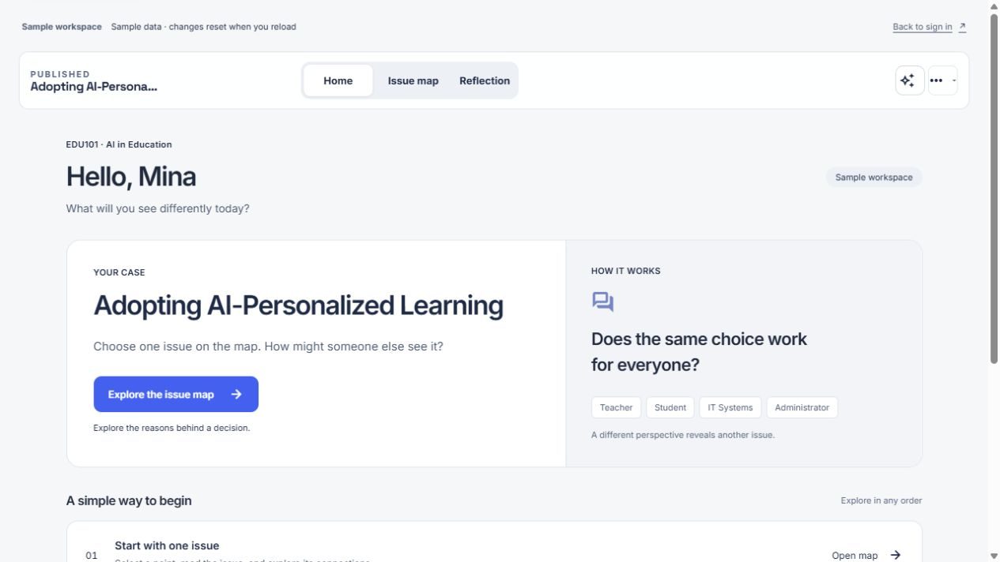
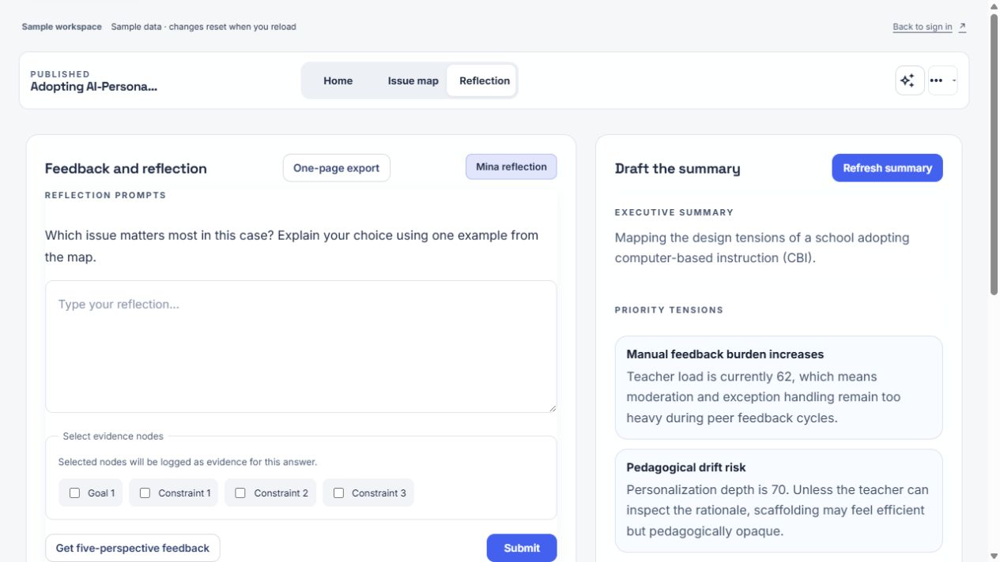

# From one issue to your own position

A short practice guide for the new student workspace. Design Tension Studio helps you examine one teaching case from different perspectives and explain a decision with evidence. You do not need every feature to begin.

## Before you start · Sample or real course?

[Practice without an account](../preview.html?lang=en) · [Sign in to your course](../index.html)

The sample uses fictional learners and a fictional case. Reloading resets it; sample answers are not submitted to a real course. For coursework, use the account and course provided by your instructor. New participants can choose **First time here? Join with a course code** on the sign-in card. This public guide contains no account passwords.

> Current-version caution: a submission message alone does not guarantee instructor receipt. Copy your original answer before submitting and follow your instructor’s receipt-check or alternative submission procedure. Long answers currently send only the first 2,000 characters; keep the response short and retain the complete original.

## 1 · Open your case

On **Home**, check the course name and case, then choose **Explore the issue map**. The button wording may change after you begin. Home → Issue map → Reflection is your main route.

Try this: read the case title and explain whose decision you are examining in one sentence.

Check: if the course or case is wrong, check the selection in **More settings**. If no case is available, ask your instructor whether it is published. Welcome slides do not open automatically.

## 2 · Read one issue

On **Issue map**, select a node and read its details. Do not infer its meaning from a number: open **Goal 1** or **Constraint 1** to find out what it represents.

Example: after finding “Device access gap,” ask, “Can a student without a device participate in the same activity?” This is a practice example, not a correct answer to memorize.

Check: can you explain why your issue matters and which case detail supports it? If the map feels crowded, use **View as a list** or **Collapse panels and focus the map**.

## 3 · Look from another perspective

Select a different perspective: **Teacher · Student · IT Systems · Administrator**. Some instructions call IT Systems “EdTech”; they refer to the same perspective here.

Practice: a student may ask whether a device is available, while a teacher may ask how much support time is needed. Write one concern from each position.

Check: what changed in your explanation? Clicking a perspective alone is not evidence of understanding. **Ask a Question** is optional; AI answers are proposals to examine, not case facts or authoritative answers.

## 4 · Add your issue and identify evidence

Use **Add issue** to write a short title and explain why it matters. Course settings may limit contributions or change who sees them. Do not include personal information in potentially shared work.

Example title: “Device loans and support time.” Reason: “Access to devices and the teacher’s capacity to support their use need to be planned together.”

Check: when you later select evidence for your reflection, match each numbered node to its actual content.

## 5 · Explain your decision

Open **Reflection**, write below the prompt, and choose relevant items under **Select evidence nodes**.

Writing frame: “I would prioritize ___. The case detail ___ supports this choice. However, from the ___ perspective, ___ may be difficult, so I would also ___.”

Optionally choose **Get five-perspective feedback** to check missing evidence or alternative views. Feedback is a suggestion to review, not an automatic grade. Sample-mode responses may differ from live AI responses.

Check: does your answer include your choice, case evidence, and another perspective’s concern? Percentages under **Design reference indicators** are not grades or scores of your writing quality.

## 6 · Keep a copy and verify receipt

1. Copy the original answer into your own document. Do not assume a draft will return after reloading or signing in again.
2. Choose **Submit**. An empty answer produces a prompt to write first.
3. In the sample, check the message stating that nothing was submitted to a course.
4. For coursework, verify what your instructor actually received. **One-page export** can be used for printing or saving a PDF; it is not a server receipt.

Do not rely on the **What to do now** checkmark to verify submission. In the current version, simply opening Reflection can mark that step complete. Do not change research consent merely to work around a submission problem.

## Frequently asked questions

### Where can I replay the tutorial?

Choose **More settings → Show Tutorial** in the app to replay the on-screen guide. The sign-in page’s **Guides** menu opens these longer guides.

### Why is Reflection or an add button missing?

Your instructor may have restricted learner views or contributions. Ask about the current course and case settings instead of creating a different course or changing settings.

### What if I cannot remember my sign-in details?

Check the invitation email or ask the operator for account recovery. Never put a password in a question, shared node, or note. Avoid repeated guesses.

### What if the map is too small on my phone?

Use the list or focus view, then scroll to read the details. Offline saving and submission are not guaranteed.

### What if AI is wrong or unavailable?

Compare its claims with the case. You can still read an issue and write your own reasoning without AI. Keep your draft before retrying a failed request.

## Finish · What can you explain now?

Can you explain one issue, contrast two perspectives, and support your own decision with case evidence? These are reflection prompts, not an automated mastery test.

[Practice again](../preview.html?lang=en) · [Instructor guide](./instructor-en.html)
